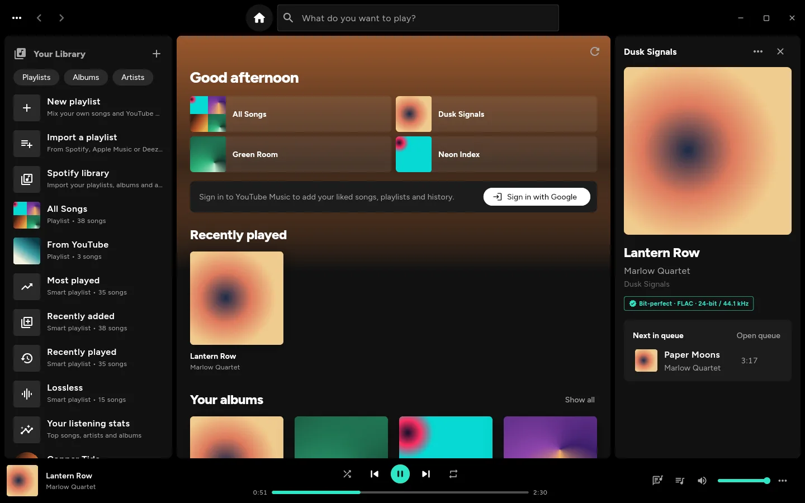
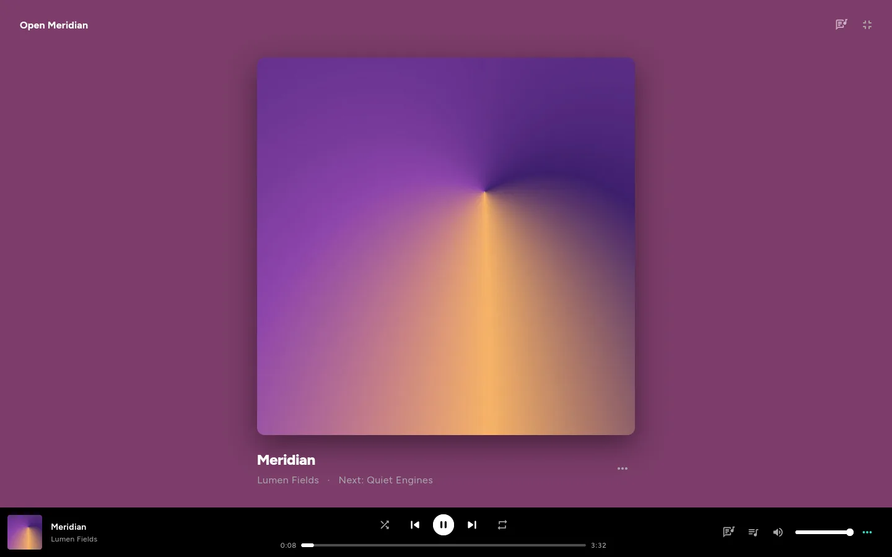
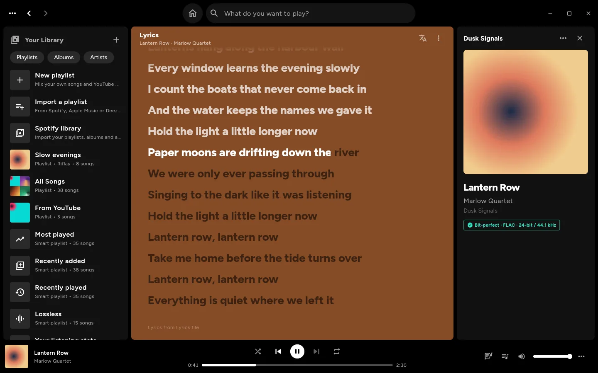
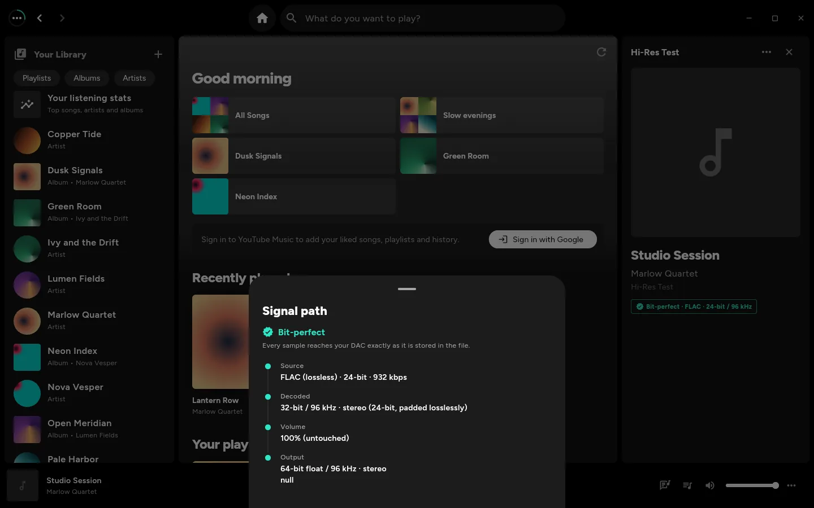
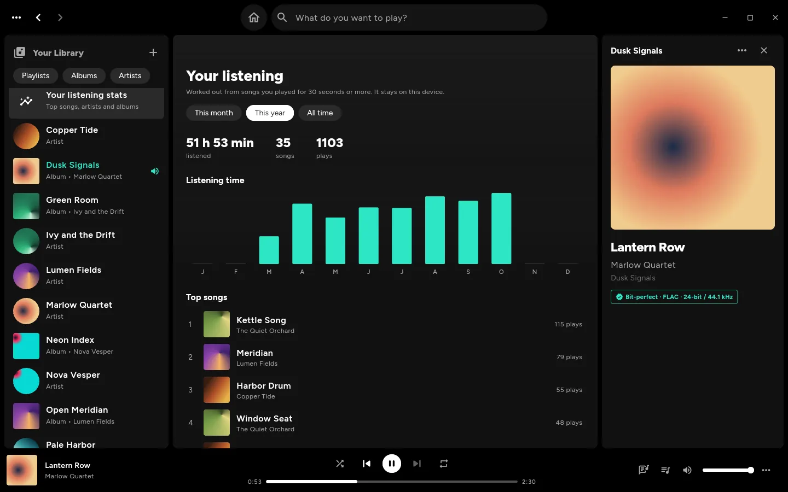
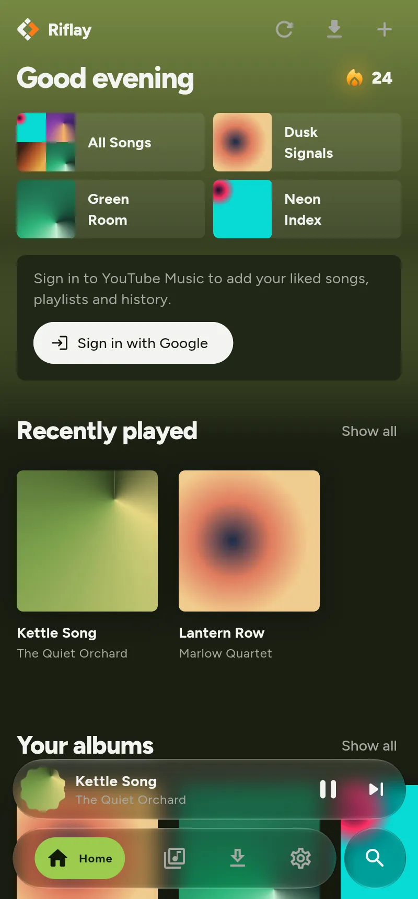
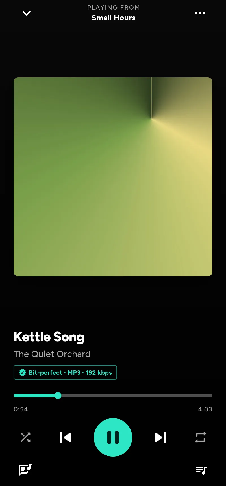
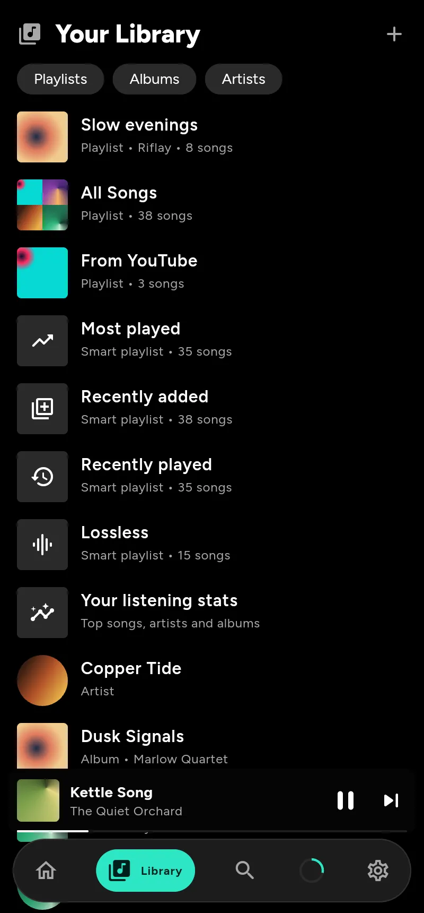

> [!WARNING]
> **Free and Open-Source Android is under threat.**
>
> Google will turn Android into a locked-down platform, restricting your essential freedom to install apps of your choice. Make your voice heard.
>
> **[Keep Android Open](https://keepandroidopen.org).**

> [!NOTE]
> **Riflay is in maintenance mode.** Work is limited to fixing issues: bug reports are welcome, new features
> are on hold for now.

<div align="center">

<picture>
  <source media="(prefers-color-scheme: dark)" srcset="assets/icon/riflay-transparent.svg">
  
</picture>

# Riflay

**Your local music and YouTube Music, together in one hi-fi player.**

Free and open source, for Linux, Windows, macOS, Android and iOS.

[](LICENSE)

[](https://github.com/Araryarch67/Riflay/releases/latest)
[](https://github.com/Araryarch67/Riflay/releases)




https://github.com/user-attachments/assets/5d0f0612-4322-425e-bbbf-79baeace47be


|  |  |
|---|---|
|  |  |

<p>
  
  
  
</p>

<sub>On a phone, in the Liquid Kawaii preset (Settings › Look & feel › Pages & navigation › Player presets).</sub>

</div>

## Features

| Area | Feature | What it does | Where |
|---|---|---|---|
| **Library** | Local files and YouTube Music together | One library and one playlist for both; no account needed, sign in only to sync | All |
| | Formats | FLAC, ALAC, WavPack, APE, MP3, Ogg, Opus, WAV, AIFF, DSD (DSF / DSDIFF), SACD ISO and cue sheets | All |
| | Folder watching | Songs added to or removed from your music folders show up on their own | All |
| | Smart playlists | Most played, Recently added, Recently played, Lossless, and more, kept up to date | All |
| | Duplicate finder | Finds the same song in more than one file and keeps the best copy | All |
| | Tag editor | Edits title, artist, album and cover; only the fields you change are written | All (Android: songs added with Add songs) |
| | Import playlists | From Spotify, Apple Music, Deezer, TIDAL or NetEase Cloud Music | All |
| | Spotify import | Brings your playlists, Liked Songs and albums over | All |
| **Streaming** | YouTube Music | Search, home, radio, likes and your library, with **Sign in with Google** | All |
| | SoundCloud | Search songs, artists and playlists; related tracks for autoplay | All |
| | Music videos | Watch a song's video in step with it, or use it as the Now Playing background | All |
| | Spotify Canvas | The looping video Spotify shows with a song, in Video mode | All |
| | Free music sources | Internet Archive FLAC recordings, Radio Paradise FLAC channels, and (opt-in) Jamendo, Audius and ccMixter | All |
| **Downloads** | Download songs | Choose format, quality and folder | All |
| | Download with MV | Keeps the song's music video beside it, to watch offline | All |
| **Hi-fi output** | Bit-perfect mode | Sends the file to the DAC untouched, no mixing or resampling | Computers, Android 14+ with a USB DAC |
| | Exclusive mode | Takes over the device so the system mixer can't resample | Windows, macOS |
| | ASIO | Low-latency output to pro audio interfaces | Windows |
| | Native DSD (DoP) | DSD goes to your DAC as it is | Computers, Android 14+ with a USB DAC |
| | USB DAC / Direct USB | Plays to a USB DAC directly, on any phone | Android |
| | Signal path | Shows every stage from file to speaker | All |
| **Sound effects** | Equalizer | Bands and presets of your own | All |
| | AutoEQ | Sets the equalizer for your headphones or IEM from their measurement | All |
| | Volume leveling | Keeps songs at the same loudness | All |
| | Virtual speakers (HRTF) | Speakers in a room on headphones, up to a 7.1 room | All |
| | Crossfeed | Makes headphones sound more like speakers | All |
| | Room correction | Loads an impulse response (e.g. from REW) | All |
| | Audio plugins | VST, LV2 and CLAP plugins through Carla | Computers |
| | Mono audio, Skip silence | Both channels in one; silent intros, outros and gaps cut short | All |
| **Playback** | Autoplay, gapless, crossfade | Keeps the music going, with or without gaps | All |
| | Sleep timer | The music fades out, then stops | All |
| | Casting | To TVs, speakers and receivers with DLNA or AirPlay | Computers, phones |
| | Listen together | Friends play along in sync over Wi-Fi or the internet, end-to-end encrypted, joined with a QR code | All |
| **Lyrics** | Synced lyrics | Follow every word, from LRCLIB, Better Lyrics, Kugou, NetEase, Musixmatch, QQ, Megalobiz, Genius and lyrics.ovh | All |
| | Pronunciation and translation | Read along in lyrics you can't read | All |
| | Your own lyrics | Use an `.lrc` file or the song's embedded lyrics, or edit them | All |
| | Lyric cards | Pick lines and share them as a picture | All |
| **Now Playing** | Build your own player | Pick the cover, top, buttons, progress bar, controls and bottom row one by one | All |
| | Presets | Classic, Stacked, Liquid Stacked, Kawaii and Liquid Kawaii | All |
| | Liquid glass | Glass controls, and a glass tab bar on phones that shrinks as you scroll | All |
| | Visualizer | Bars, dots, line, mirror, orbit, peaks, petals, pulse, twin waves and wave | All |
| | Backgrounds | Plain colour, blurred cover, the music video, or black | All |
| | Full screen | A full-screen player with lyrics | All |
| **Look & feel** | Themes | Default, Dynamic (from the playing song's cover), Monochrome, Catppuccin, Everforest, Everblush, Nord, Gruvbox, Tokyo Night, Dracula, Rosé Pine, Custom and Matugen colours; dark, light or follow the system | All |
| | Layout | Phone tab bar styles, desktop bar styles, corners, density, cover size and motion | All |
| | Language and text | English, Indonesian and Japanese; text size and any font on your device | All |
| **Stats** | Listening stats | Top songs, artists and albums, kept on your device | All |
| | Riflay Wrap | Your month in music, ready to share | All |
| | Last.fm and ListenBrainz | Adds the songs you play to your profile there, even offline | All |
| | Discord | Shows what you play on your Discord profile | Computers |
| **Your device** | Performance modes | Lightweight, Balanced and Heavy | All |
| | Media controls | Notification, Control Center and MPRIS | All |
| | Tray icon | Close to tray and control from the tray menu | Computers |
| | Backup and restore | Your settings, playlists and history in one file | All |
| | Settings search | Find any setting by name, with a preview | All |
| | Riflay CLI | Control the desktop player from a terminal or an AI agent, with JSON output | Computers |
| | Riflay Web | YouTube Music in a browser, through its own proxy | Web |

"Computers" means Windows, macOS and Linux; "All" means every app, while Riflay Web has a smaller set. [Audio and platform notes](docs/platforms.md) has every setting's details.

## Install

Every file is on the [latest release](https://github.com/Araryarch67/Riflay/releases/latest), with `SHA256SUMS`.

| System | Install |
|---|---|
| Windows | `scoop bucket add riflay https://github.com/Araryarch67/scoop-riflay` then `scoop install riflay/riflay`, or the `setup.exe` / `.zip` |
| Debian, Ubuntu, Mint | `sudo apt install ./Riflay-linux-amd64.deb` |
| Fedora / openSUSE | `sudo dnf install ./Riflay-linux-x86_64.rpm` / `sudo zypper install ./Riflay-linux-x86_64.rpm` |
| Arch | `sudo pacman -U Riflay-linux-x86_64.pkg.tar.zst` |
| Linux or macOS, with Homebrew | `brew install --cask araryarch67/riflay/riflay` |
| Any Linux | the `.AppImage` (`chmod +x`, then run it) |
| Android | `Riflay-android.apk` (Android 7.0 and later) |
| macOS | `Riflay-macos.dmg` (macOS 12 and later) |
| iOS | `Riflay-ios-unsigned.ipa`, sideloaded with AltStore or Sideloadly |

The macOS app is unsigned: on first launch use System Settings › Privacy & Security › **Open Anyway**. The iOS file is attached to a release a little after the others.

## System requirements

| System | Version | Processor |
|---|---|---|
| Windows | 10 or 11, 64-bit | x64 |
| Linux | a 64-bit distribution with GTK 3, on Wayland or X11, and a working OpenGL driver; PipeWire, PulseAudio or ALSA | x86_64 |
| macOS | 12 Monterey or later | Apple silicon or Intel |
| Android | 7.0 or later | arm64, arm32 or x86_64 |
| iOS | 15 or later (sideloaded) | arm64 |

On a computer Riflay picks a performance mode at first start (Settings › Power & background changes it):

| | Lightweight | Balanced | Heavy |
|---|---|---|---|
| Suits | under 8 GB of memory, or fewer than 8 processor threads | laptops and most desktops | desktops with 16+ threads and 16+ GB |
| Moves | the seek bar, about once a second | cover and wave at 5 fps, visualizer at 10 | everything at 30 fps |
| CPU while a song plays, in front | ~3% of one thread | ~8% | ~14% |

Phones keep Balanced, except one with under 4 GB of memory, which starts in Lightweight (the music video at 720p
instead of 1440p). At least 4 GB of memory is recommended on a computer for the system, Riflay and a browser beside it. Riflay itself measured on
Linux (release build, private memory): ~150 MB idle, ~200-230 MB playing or scrolling a library of covers, ~300 MB
with a 1080p music video, and 65-110 MB while it plays behind other windows (it hands unused memory back to the
system then; Windows does the same). Behind other windows every mode draws about one frame a second. The app takes
about 40 MB on disk on Linux (plus the system's libmpv) and a few hundred MB elsewhere, where libmpv comes with it;
downloads and the cover cache need room of their own.

## Build from source

You need the [Flutter SDK](https://docs.flutter.dev/get-started/install) (stable) and the desktop toolchain; on Linux also `clang`, `cmake`, `ninja`, `pkg-config`, GTK 3, the `libmpv` headers and `libayatana-appindicator3` (the tray icon; `libayatana-appindicator3-dev` on Debian and Ubuntu).

```sh
git clone https://github.com/Araryarch67/Riflay.git
cd Riflay
flutter pub get
flutter run -d linux          # or: windows, macos, android, ios
```

## More

- [Riflay CLI](docs/cli.md): control the desktop player from a terminal or AI agent, with JSON output.
- [Audio and platform notes](docs/platforms.md): YouTube Music sign-in, every audio setting, and what works on which system.
- [Riflay in a browser](docs/web.md): the web version and its proxy.
- [Contributing](CONTRIBUTING.md) and [AGENT.md](AGENT.md) (how the code is organized and tested).

## Acknowledgements

Riflay builds on the work of:

| Project | Used for | License |
|---|---|---|
| [mpv](https://mpv.io) / [media_kit](https://github.com/media-kit/media-kit) | Playback | LGPL-2.1-or-later |
| [just_audio](https://github.com/ryanheise/just_audio) | Playback | MIT |
| [FFmpeg](https://ffmpeg.org) | Decoding and filters | LGPL-2.1-or-later; some builds enable GPL components |
| [SoX's resampler](https://sourceforge.net/projects/soxr/) | Resampling | LGPL-2.1-or-later |
| [yt-dlp](https://github.com/yt-dlp/yt-dlp) | YouTube audio | Unlicense |
| [youtube_explode_dart](https://github.com/Hexer10/youtube_explode_dart) | YouTube audio | MIT |
| [ytmusicapi](https://github.com/sigma67/ytmusicapi) | Documentation of YouTube Music's API, which this app follows | MIT |
| [LRCLIB](https://lrclib.net), [Better Lyrics](https://betterlyrics.org), Kugou, NetEase Cloud Music, QQ Music, Musixmatch, [Megalobiz](https://www.megalobiz.com), [Genius](https://genius.com), [lyrics.ovh](https://lyrics.ovh) | Free lyrics | Various; see each project |
| [audio_metadata_reader](https://github.com/ClementBeal/audio_metadata_reader) | Tags | MIT |
| Bill Gardner and Keith Martin's [KEMAR HRTF measurements](https://sound.media.mit.edu/resources/KEMAR.html) (MIT Media Lab) | Virtual speakers and its 7.1 room | MIT |
| [Internet Archive](https://archive.org) | Free FLAC recordings in search, streamed from archive.org | Each recording's own license |
| [Radio Paradise](https://radioparadise.com) | Listener-supported FLAC radio channels | Free to listen; please support them |
| [AutoEq](https://github.com/jaakkopasanen/AutoEq) by Jaakko Pasanen, with measurements by crinacle, oratory1990 and others | Headphone / IEM equalizer profiles, downloaded when picked | MIT |
| [akagi](https://github.com/z0orb/akagi) | Ideas behind playlist reordering and Downloads storage overview (re-implemented, no code copied) | MIT |
| [liquid_glass_renderer](https://github.com/whynotmake-it/flutter_liquid_glass/tree/main/packages/liquid_glass_renderer) | The phone's Liquid glass tab bar | Apache-2.0 |
| Apple Music on iOS 26 | Idea behind the Liquid glass tab bar that shrinks to one row on scroll and carries the search field (re-implemented, no code copied) | — |

### Special thanks

**[Houshou Marine](https://www.youtube.com/@HoushouMarine)** (hololive). Her song "きゃぴ - Kyapi" and its music video are
the reference test for Riflay's performance work. Every CPU and memory target is measured while it plays: the music video,
the synced lyrics with their pronunciation, and full screen. The song and video are streamed from YouTube when the test
runs; nothing of them ships with Riflay.

Riflay is not affiliated with YouTube, Google, Discord, Apple, hololive or COVER Corporation.

## License

Riflay is free software: you can redistribute it and/or modify it under the terms of the **GNU Affero General Public License v3.0** as published by the Free Software Foundation. See [LICENSE](LICENSE).

If you run a modified version for others over a network, the AGPL asks you to offer them its source too.

Vendored packages in [`third_party/`](third_party) keep their own licenses: Unlicense for `just_audio_media_kit`, MIT for `audio_metadata_reader` and the `media_kit_libs_*` packages, and GPL-3.0-or-later or the Steinberg ASIO license for `asiosdk` (see its [license file](third_party/asiosdk/LICENSE.txt)). Flutter and Dart packages generally use MIT or BSD-3-Clause licenses; each package ships its own license in the dependency cache. Native dependencies and downloaded tools retain their upstream licenses; in particular, FFmpeg may be built with optional GPL components.
