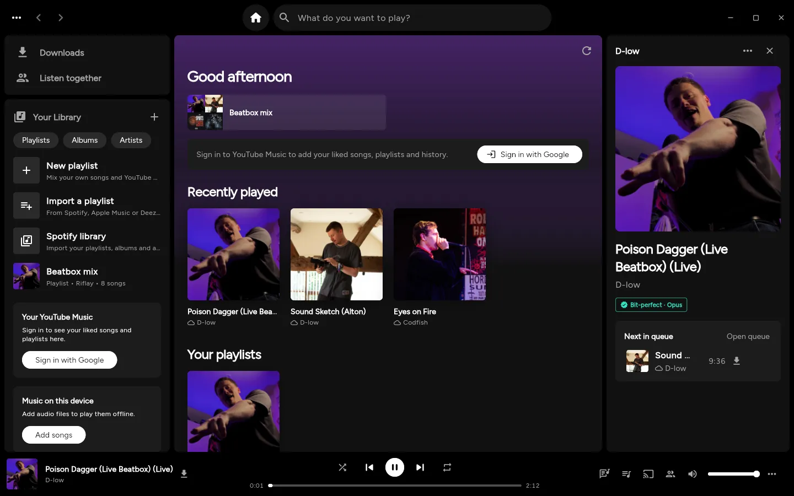
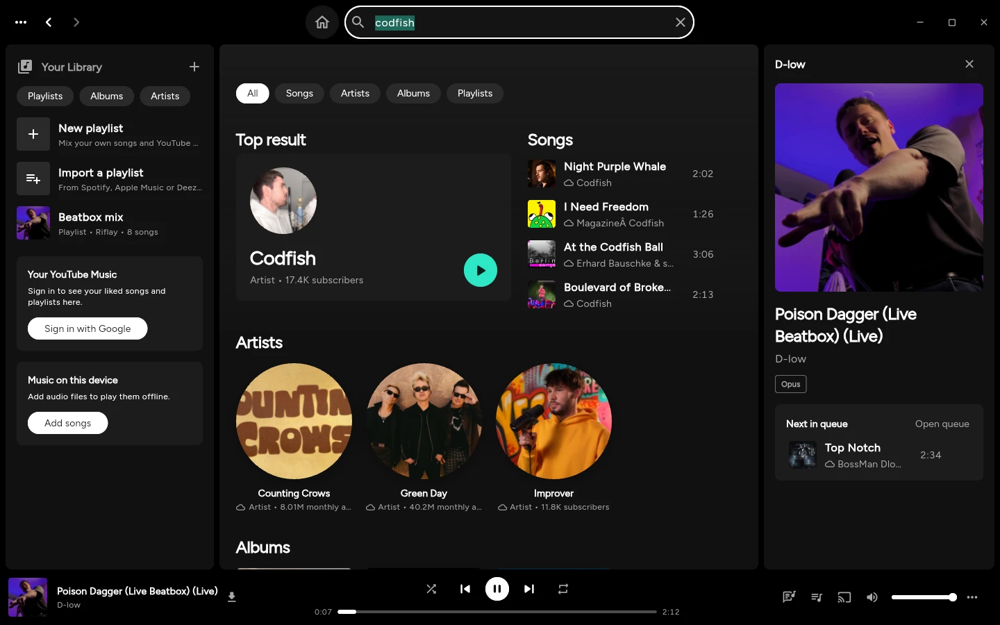
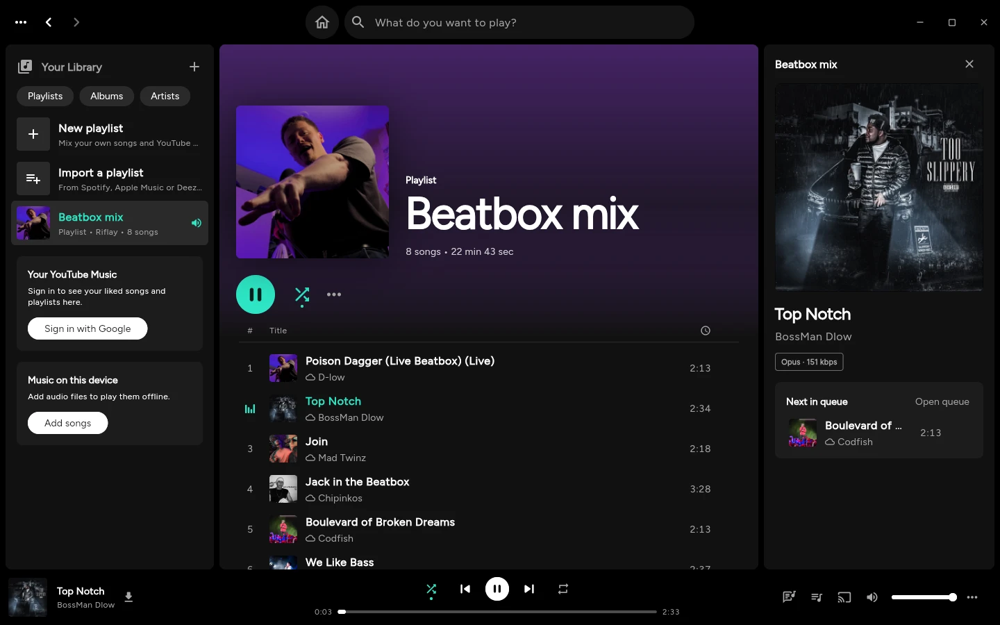
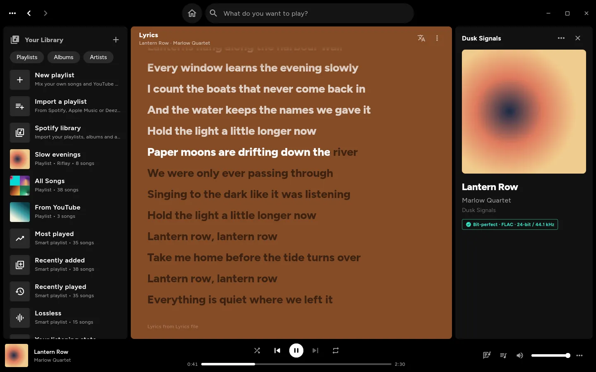
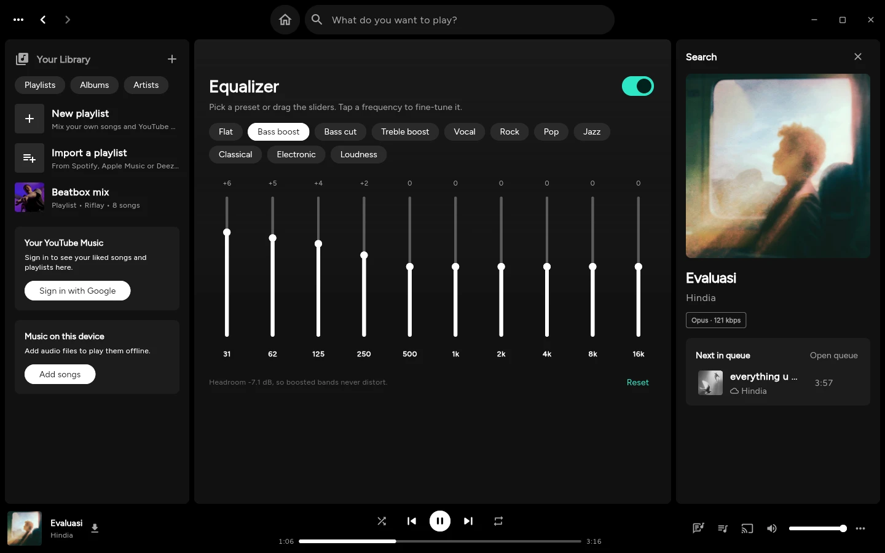
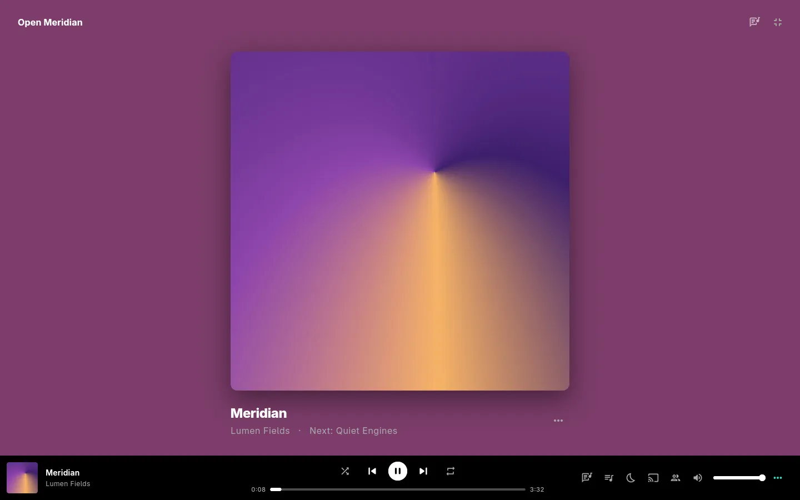
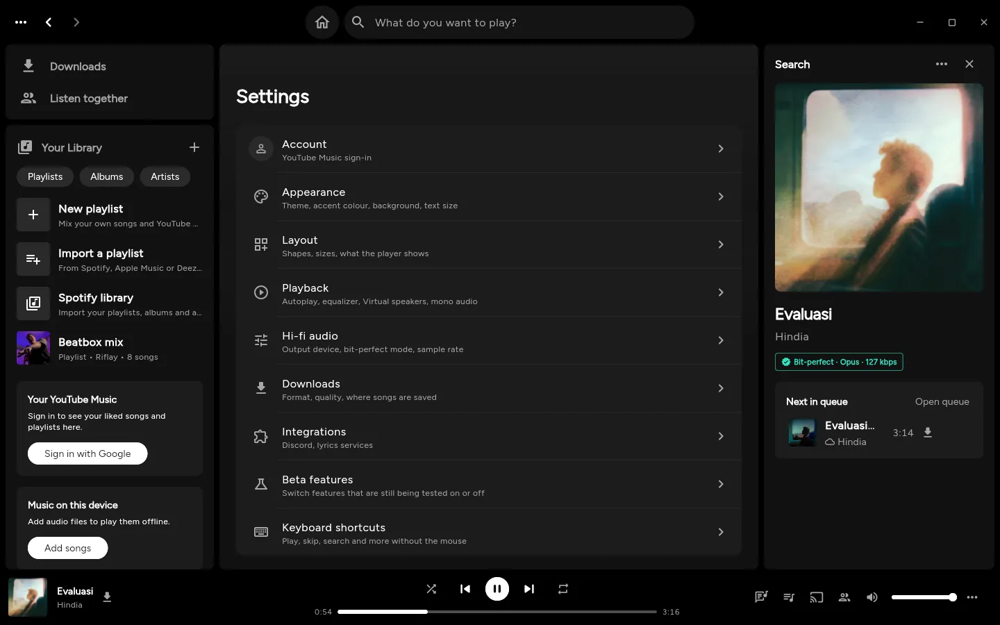
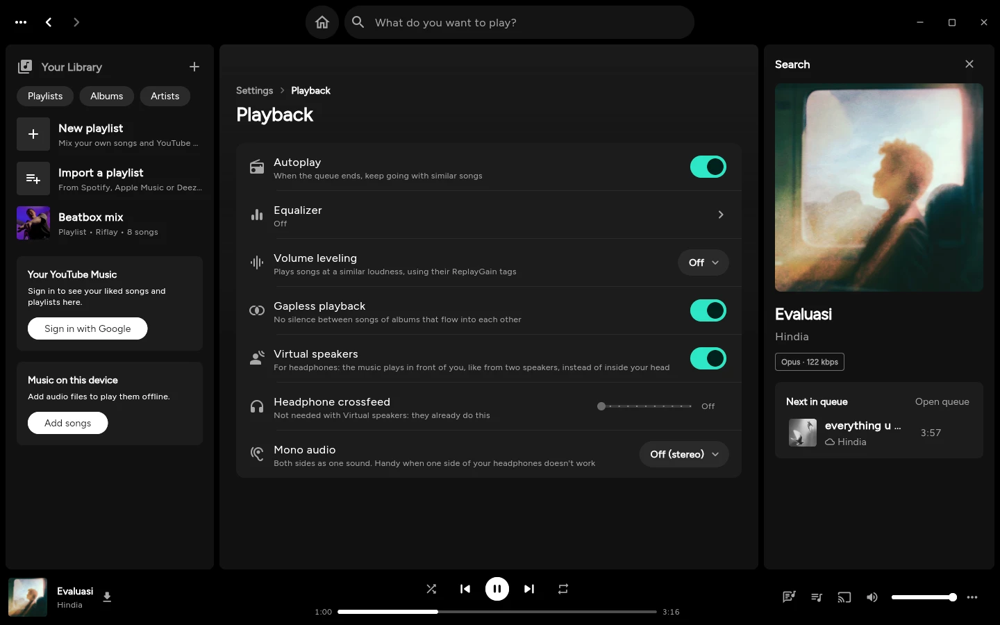
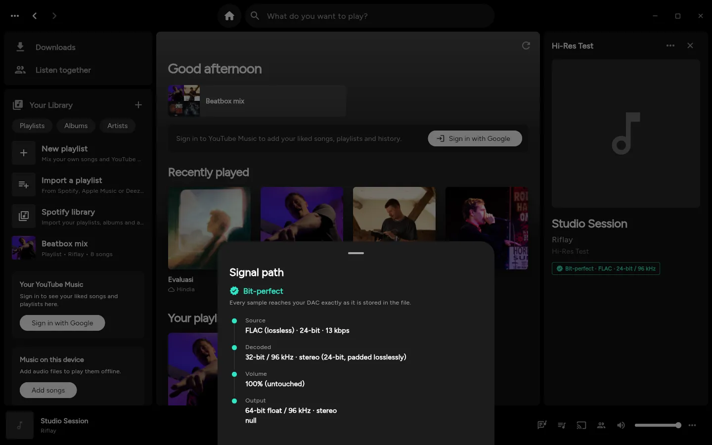
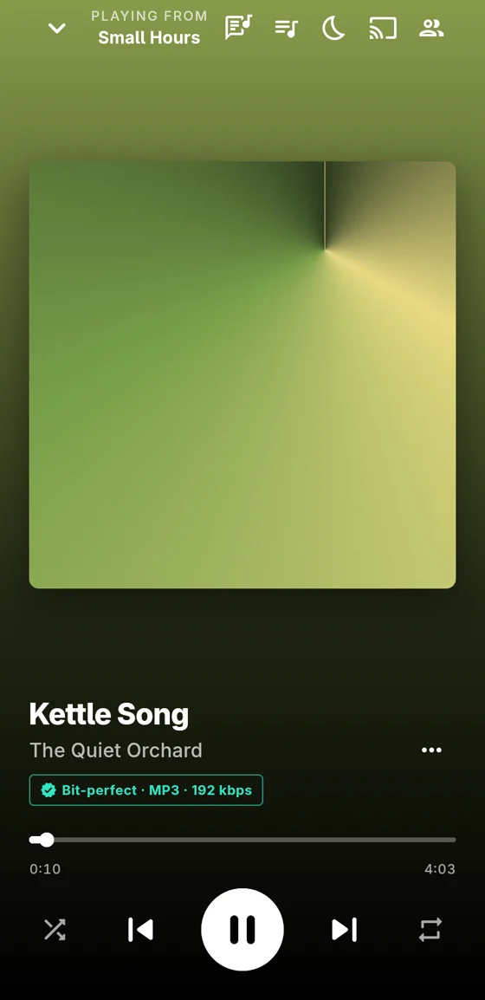

<div align="center">

<picture>
  <source media="(prefers-color-scheme: dark)" srcset="assets/icon/riflay-transparent.svg">
  
</picture>

# Riflay

**Your local music and YouTube Music, together in one hi-fi player.**

Riflay is a free, open-source music player for Linux, Windows, macOS, Android and iOS, built with Flutter. It was previously released as OpenMusic.

[](LICENSE)
[](https://flutter.dev)

[](CONTRIBUTING.md)



</div>

## Table of contents

- [Features](#features)
- [Screenshots](#screenshots)
- [Build from source](#build-from-source)
- [YouTube Music](#youtube-music)
- [Audio](#audio)
- [Platform notes](#platform-notes)
- [Contributing](#contributing)
- [Acknowledgements](#acknowledgements)
- [License](#license)

## Features

| Feature | Description |
|---|---|
| **One library** | Local files, playlists and YouTube Music in a single library |
| **Format support** | FLAC, ALAC, WAV, AIFF, MP3, AAC, Ogg, Opus, WavPack, APE, DSD, SACD ISO and cue sheets |
| **YouTube Music** | Fully usable without an account. Sign in with Google to sync likes, playlists and history. Moods & genres, new releases, save albums and playlists to your library |
| **Synced lyrics** | Word by word where the source times each word, otherwise line by line; pronunciation, translation, copy, your own .lrc files, and saved with downloads |
| **Playlists** | Combine local files with YouTube songs, and drag songs into any order. Import from Spotify, Apple Music or Deezer |
| **Downloads** | Shows how much space your downloads use, and finds downloaded songs whose file was deleted so you can download them again or remove them |
| **Autoplay and radio** | Plays similar songs when the queue ends |
| **Equalizer** | 10-band parametric, with presets and automatic headroom to prevent clipping |
| **Virtual speakers** | Simulates two front-facing speakers on headphones (HRTF) |
| **Mono audio** | Mixes both channels to one or both ears. For headphones with a dead side |
| **Crossfeed** | Softens stereo separation on headphones |
| **Room correction** | Applies an impulse response, for example from REW |
| **Volume leveling** | ReplayGain, per song or per album |
| **Gapless playback** | No silence between consecutive tracks |
| **Bit-perfect and DSD** | Sends the file to the DAC untouched, native DSD (DoP), exclusive mode |
| **Audio plugins** | VST, LV2 and CLAP through Carla (Linux, Windows, macOS) |
| **Signal path** | Shows every processing stage from file to speaker |
| **Play on TVs and speakers** | DLNA / UPnP and AirPlay |
| **Listen together** | Friends play along with your YouTube songs, in sync. On the same Wi-Fi, or anywhere with a code (beta: connects through free public servers, end-to-end encrypted) |
| **Tag editor** | Preserves ReplayGain and custom tags |
| **Customization** | Catppuccin, Nord, Gruvbox, Dracula or your own colors. Any font and accent. Light, dark or match your system, for every theme. Dynamic theme (beta) follows the cover of what's playing, local or YouTube. Cover-art colors in the player or the whole app, with adjustable strength. High contrast |
| **Layout options** | Corners, spacing, cover size, Home sections, player and lyrics looks, animations |
| **Adaptive layouts** | Phone, tablet and desktop. Mini and full-screen player |
| **Background playback** | Keeps playing with the screen off. Optionally keeps the screen on, or the computer awake, while playing |
| **System integration** | Lock screen, notification, Control Center, MPRIS, media keys, Discord |
| **Fast** | A YouTube song starts in about 0.3 s |

## Screenshots

| Search: local music and YouTube Music | A playlist mixing artists |
|---|---|
|  |  |
| **Synced lyrics** | **Equalizer** |
|  |  |
| **Full-screen player** | **Settings** |
|  |  |
| **Virtual speakers and Mono audio** | **Signal path** |
|  |  |
| **On a phone** | |
|  | |

## Build from source

You need the [Flutter SDK](https://docs.flutter.dev/get-started/install), stable channel, plus the standard desktop toolchain. On Linux this means `clang`, `cmake`, `ninja`, `pkg-config`, GTK 3 and the `libmpv` headers.

```sh
git clone https://github.com/Araryarch67/Riflay.git
cd Riflay
flutter pub get
flutter run -d linux          # or: windows, macos, android, ios
flutter build linux --release # build/linux/x64/release/bundle/
```

On macOS and iOS, the first build also compiles libmpv from source (`tool/build_libmpv_apple.sh`, about ten minutes). This requires Homebrew's `meson`, `ninja`, `nasm` and `pkgconf`.

After pulling changes that add packages, quit the app and run `flutter run` again. Hot reload does not load new plugins.

## YouTube Music

All public YouTube Music features work without an account. **Sign in with Google** opens Google's own sign-in page, in a separate window on Linux and inside the app on other platforms. Once the sign-in completes, the session is stored in the app's private storage on your device. Riflay never sees your password, and nothing is sent anywhere except to YouTube Music itself.

Changes you make (likes, playlists) go through YouTube Music's own API, so they also appear in the official apps.

## Audio

Every platform plays through [libmpv](https://mpv.io), using Riflay's own build where the stock one lacks filters (Windows, Android, macOS, iOS; see `tool/build_libmpv_*.sh`). The audio settings are therefore the same on every platform:

| Area | Details |
|---|---|
| **Playback** (Settings) | Equalizer with presets and automatic headroom, volume leveling (ReplayGain per song or album), gapless playback, **Virtual speakers** (MIT's KEMAR HRTF: two speakers at ±30°), headphone crossfeed, **Mono audio** (both ears, left only or right only) |
| **Hi-fi audio** | Room correction (an impulse response); output sample rate; SoX resampler; buffer size. On desktop also: output device, including direct ALSA hardware on Linux; **bit-perfect mode**; **exclusive mode** (WASAPI on Windows, Core Audio hog mode on macOS); **native DSD (DoP)** for DSF, DSDIFF and SACD songs; **ASIO** on Windows; **audio plugins** through [Carla](https://kx.studio/Applications:Carla). On Android 14 and later with a USB DAC: **bit-perfect mode** and **native DSD (DoP)**. On iOS: the output picker, and a USB DAC follows each song's sample rate |
| **Play on** | DLNA / UPnP renderers and classic AirPlay speakers, found on the network. Files the device cannot play (DSD, cue-sheet songs, WavPack, ...) are converted to FLAC on the fly; YouTube songs are sent as AAC; AirPlay receives ALAC |
| **Signal path** | Source codec and stored bit depth → decoder → every DSP stage → volume → resampler → output device, with a verdict: *Bit-perfect*, *Lossless to the system mixer* or *Processed* |

Not yet verified on real hardware: ASIO, exclusive mode, and casting to physical TVs and speakers (tested under Wine, against a simulated renderer and shairport-sync). On macOS and iOS: everything beyond the automated checks GitHub's runners perform. Reports from real devices are welcome.

## Platform notes

| | Linux | Windows | macOS | Android | iOS |
|---|---|---|---|---|---|
| Sound settings, signal path | ✓ | ✓ | ✓ | ✓ | ✓ |
| Output device, bit-perfect, DSD, exclusive | ✓ | ✓ | ✓ | partial¹, untested | partial², untested |
| ASIO | not needed³ | ✓ | not needed³ | N/A | N/A |
| Add a folder | ✓ | ✓ | ✓ | ✓ | ✓, untested |
| Tag editor, cover art | ✓ | ✓ | ✓ | partial⁴ | ✓, untested |
| AirPlay | ✓ | ✓ | untested | untested | partial⁵, untested |
| Play on TVs (DLNA), with conversions | ✓ | ✓ | untested | untested | partial⁵, untested |
| Discord | ✓ | ✓ | ✓ | N/A⁶ | N/A⁶ |
| Audio plugins (Carla) | ✓ | ✓⁷ | ✓⁷ | N/A⁷ | N/A⁷ |
| See-through window | ✓ | untested⁸ | untested⁸ | ✓⁸ | N/A⁸ |

✓ means the feature works and has been verified (tests, CI on that OS, an emulator or Wine). **untested** means it is built for that OS but has not yet been tried on a real device; reports from real devices are welcome.

1. Android 14 and later with a USB DAC: bit-perfect mode sends the song to the DAC untouched through Android's bit-perfect USB output, and native DSD goes as DoP when the DAC accepts 176.4 kHz. Android chooses the output itself (a plugged-in USB DAC), so there is no picker or exclusive mode.
2. Pick the output (speaker, Bluetooth, AirPlay, a USB DAC) with the system picker. A USB DAC follows each song's sample rate (FLAC, WAV, AIFF, WavPack). iOS always mixes, so it is never bit-perfect, and DSD plays as PCM.
3. ASIO is a Windows driver standard. Linux and macOS have the same direct path to the DAC built in: bit-perfect mode (ALSA's hardware device) and exclusive mode (Core Audio's hog mode), in the row above.
4. Songs added with **Add songs** can be edited. Songs read in place from a folder are read-only to apps since Android 11. Matroska (.mka) tags can be edited on computers only.
5. Playing and converting work. Finding speakers and TVs on the network normally requires a multicast permission from Apple that a sideloaded app cannot have. AirPlay sends 44.1 kHz / 16-bit everywhere (AirPlay 1).
6. Phones give other apps no connection to Discord.
7. Carla is a separate free download: unzip it into Downloads or Program Files on Windows, put Carla.app in Applications on macOS. Android has no plugin standard, and iOS's AUv3 plugins are not supported yet.
8. A blur behind the window on Windows 11 and macOS (plain transparency on Windows 10); the home-screen wallpaper on Android. iOS does not let apps show the wallpaper.

YouTube streams through YouTube's player API everywhere, with yt-dlp (desktop) or a built-in extractor (phones) as the fallback. yt-dlp needs a JavaScript runtime (Deno or Node) for some YouTube challenges.

No additional installation is required. Conversions for AirPlay and TVs, and the tag editor, run inside Riflay (libmpv and its own tag writers). FFmpeg is used only for AirPlay and TV conversions on Windows and for Matroska tags on computers: a system one where one exists; otherwise the official static build (gyan.dev on Windows, johnvansickle.com on Linux, Martin Riedl's on macOS, about 40 MB) is downloaded on first use, checked against its published checksum and stored in the app's folder.

The macOS app is not signed by Apple. On first launch, open it from System Settings › Privacy & Security › **Open Anyway**. The iOS `.ipa` is unsigned as well; sideload it with AltStore or Sideloadly.

Debug builds append every Flutter error with its full stack trace to `<app support dir>/errors.log` (on Linux, `~/.local/share/dev.riflay.riflay/errors.log`).

## Contributing

Bug reports, feature requests and pull requests are welcome. Start with **[CONTRIBUTING.md](CONTRIBUTING.md)**. **[AGENT.md](AGENT.md)** documents how the code is organized and how to test it. It is written for coding agents, but equally useful for human contributors.

## Acknowledgements

Riflay builds on the work of:

- [mpv](https://mpv.io) / [media_kit](https://github.com/media-kit/media-kit) and [just_audio](https://github.com/ryanheise/just_audio) for playback
- [FFmpeg](https://ffmpeg.org) for decoding, filters and resampling (with [SoX's resampler](https://sourceforge.net/projects/soxr/))
- [yt-dlp](https://github.com/yt-dlp/yt-dlp) and [youtube_explode_dart](https://github.com/Hexer10/youtube_explode_dart) for YouTube audio
- [ytmusicapi](https://github.com/sigma67/ytmusicapi), whose documentation of YouTube Music's API this app follows
- [LRCLIB](https://lrclib.net), [Better Lyrics](https://betterlyrics.org), Kugou, NetEase Cloud Music, QQ Music, Musixmatch (Beta), [Megalobiz](https://www.megalobiz.com), [Genius](https://genius.com) and [lyrics.ovh](https://lyrics.ovh) for free lyrics
- [audio_metadata_reader](https://github.com/ClementBeal/audio_metadata_reader) for tags
- Bill Gardner and Keith Martin's [KEMAR HRTF measurements](https://sound.media.mit.edu/resources/KEMAR.html) (MIT Media Lab) for Virtual speakers
- [akagi](https://github.com/z0orb/akagi), whose ideas inspired dragging songs into order in playlists and the Downloads page's storage overview (re-implemented, no code copied)

Riflay is not affiliated with YouTube, Google or Discord.

## License

Riflay is free software: you can redistribute it and/or modify it under the terms of the **GNU Affero General Public License v3.0** as published by the Free Software Foundation. See [LICENSE](LICENSE).

If you run a modified version for others over a network, the AGPL asks you to offer them its source too.

Vendored packages in [`third_party/`](third_party) keep their own licenses (the Unlicense for `just_audio_media_kit`, MIT for `audio_metadata_reader` and the `media_kit_libs_*` packages, GPLv3 for Steinberg's `asiosdk`).
